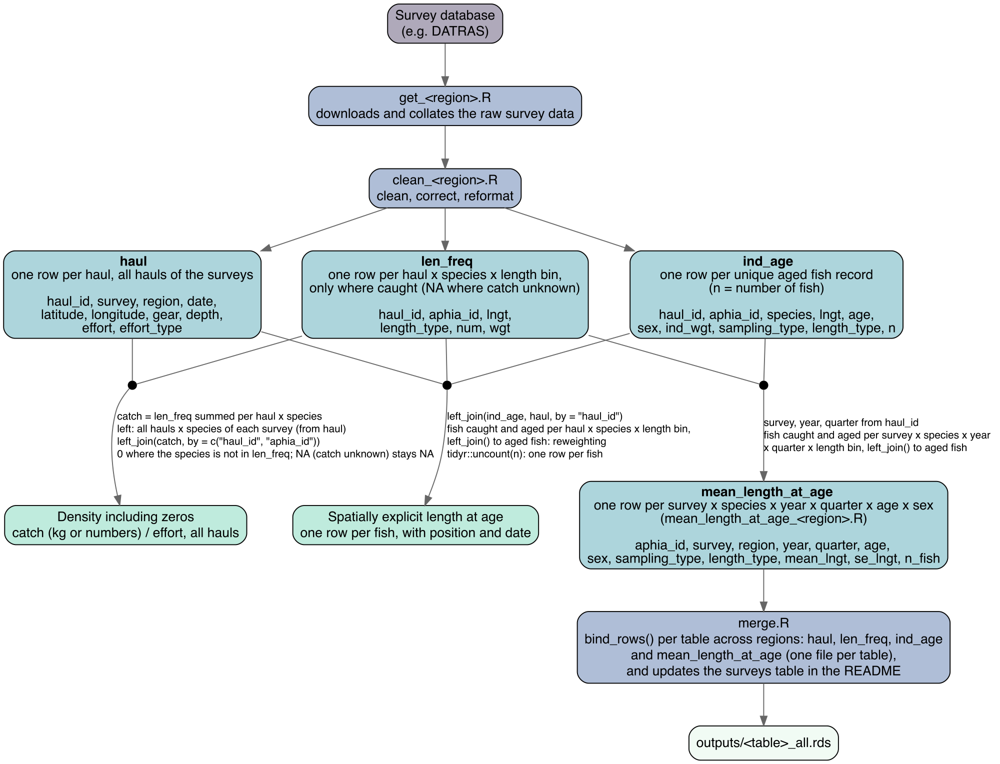

# wggrafy-data

### This is a prototype only, not fully reviewed yet. Do not use without consulting!

Data collation pipeline for [ICES WGGRAFY](https://www.ices.dk/community/groups/Pages/Wggrafy.aspx) (Working Group on Impacts of Warming on Growth Rates and Fisheries Yields). The goal is a standardised, multi-region dataset of size-at-age observations from scientific bottom trawl surveys, for use in growth analyses.

The structure is inspired by [FISHGLOB](https://github.com/fishglob/FishGlob_data) ([Maureaud et al. 2024](https://doi.org/10.1038/s41597-023-02866-w)), but each region has its own cleaning pipeline that handles all surveys within it and standardises them to a common format. A final script merges all regions.

Scientific trawl surveys are conducted with different sampling protocols, but commonly length-at-age and growth are determined from some sort of length-stratified subsample of the catch in a haul that is later aged. When this aged subsample is not random (rare, if it ever occurs), you can end up with biased estimates when working with it directly, e.g. to estimate mean length-at-age or growth. If the aged subsample is a length-stratified sample of the catch, you can fix this bias using information on the length distribution of the sample from which the aged subsample was taken (e.g. [Bettoli & Miranda (2001)](https://doi.org/10.1577/1548-8675(2001)021%3C0425:CNAEML%3E2.0.CO;2)). There are many methods for dealing with this bias. Here we work with two approaches, depending on whether one wants to work with the aged subsample directly, or estimate mean length-at-age over some larger scale.

1. **Working with the aged fish individually**, e.g. for spatially explicit modelling of growth or length at age. A relatively simple and promising method is the "reweighting" method of [Chih (2009)](https://doi.org/10.1577/M09-018.1). It allows the analyst to work with the aged subsample directly, as had it been random, by including the ratio between two proportions as a likelihood weight for each fish: 1) the proportion of fish in the entire sample that belonged to the fish’s length bin and 2) the proportion of fish in the aged subsample that belonged to the fish’s length bin (see also [Perreault et al. (2020)](https://doi.org/10.1139/cjfas-2019-0129); [Hilling et al. (2020)](https://doi.org/10.1002/nafm.10429); [Lusk et al. (2021)](https://doi.org/10.1002/nafm.10570); and references therein).

2. **A weighted estimate of mean length at age and its variance**, e.g. for averages at a larger scale, say year. Here we use the method of [Bettoli & Miranda (2001)](https://doi.org/10.1577/1548-8675(2001)021%3C0425:CNAEML%3E2.0.CO;2) for `mean_length_at_age` (one estimate per survey × species × year × quarter × age × sex, see below). It estimates the mean length at age of the fish in the entire sample, not only of those in the aged subsample, by extrapolating the aged subsample to the entire sample. Specifically, each aged fish stands for N<sub>j</sub> / n<sub>j</sub> fish, where N<sub>j</sub> and n<sub>j</sub> are the numbers of fish in its length bin in the entire sample and in the aged subsample, and the mean length at age and its variance are computed with these weights. This is the same as applying the age-length key of the aged subsample to the length distribution of the entire sample.

The two approaches are equivalent: Chih's weight, (N<sub>j</sub> / N) / (n<sub>j</sub> / n), with N and n the total numbers caught and aged, is Bettoli & Miranda's N<sub>j</sub> / n<sub>j</sub> times n / N. This factor is the same for all fish in a sample, so it only rescales the weights (to the aged subsample instead of the catch) and gives the same weighted mean. So both approaches need, in addition to the length-at-age data, the length distribution of the entire sample, i.e. the number of fish caught per length bin (`len_freq`).

Hence, so that a user can estimate bias-corrected length-at-age, this repository is built around three connected data products and one derived summary:

- **Hauls** (`haul`): one row per haul, for all hauls of the surveys (position, date, gear, depth and effort). Joined to `ind_age` and `len_freq` by `haul_id`, to link the biological data to where and when they were sampled for spatially-explicit growth modelling, and to create zeros (hauls where a species was not caught).
- **Individual length-at-age records** (`ind_age`): measured and aged fish. One row per unique aged fish record (`n` is the number of fish in that row; expand with `tidyr::uncount(n)` to get one row per fish).
- **Length-frequency distributions** (`len_freq`): catch in numbers and weight by length bin (one row per haul × species × length bin), covering all length bins regardless of whether fish were aged. Summed over length bins, it gives the catch per haul and species.

The derived product, `mean_length_at_age`, contains summarised length at age per survey × species × year × quarter × age × sex (mean and standard error, weighted to the catch with `len_freq` as described above).

See [Structure of the data tables](#structure-of-the-data-tables) for more details.

## Using the data

To use the compiled data, either:

- Use the merged outputs in **[outputs/](outputs/)** (`haul_all.rds`, `len_freq_all.rds`, `ind_age_all.rds`, `mean_length_all.rds`); or

- Use the region-specific cleaned files (e.g. `outputs/north_east_atlantic_datras/nea_datras_haul.rds`, `nea_datras_len_freq.rds`, `nea_datras_ind_age.rds` and `nea_datras_mean_length_at_age.rds`).

The output format is defined in **[standard_formats/](standard_formats/)**.

## Repository structure

- **[cleaning_codes](cleaning_codes)** contains one subfolder per region. For example, `north_east_atlantic_datras` contains a `get_` script (download and collate), a `clean_` script (clean, correct, reformat), a `mean_length_at_age_` script (mean length at age from the cleaned tables) and a `cleaning_notes/` folder documenting how the region's data are cleaned (corrections, decisions and open issues; the figures of the notes and the scripts that make them are in `cleaning_notes/figures/`). This folder also contains `merge.R`, which combines all regions and updates the README overview of surveys.
- **[standard_formats](standard_formats)** defines the common output format (column names, types, units) that every regional pipeline must conform to.
- **[outputs](outputs)** contains the cleaned and merged `.rds` files: one subfolder per region (named as the folder in `cleaning_codes/`) with that region's cleaned files, and the merged files at the top level.
- **[raw_data](raw_data)** holds the raw downloaded survey files, organised into one subfolder per region (gitignored due to size).
- **[summary](summary)** contains overview figures of data coverage by species, survey, and year, the workflow figure, and the scripts that make them.
- **[metadata_docs](metadata_docs)** describes the surveys and their data sources, one file per region (e.g. [`ices_datras.md`](metadata_docs/ices_datras.md)).
- **[TODO.md](TODO.md)** lists open tasks for the repository as a whole; open issues in the data of each region are in the To do sections of its cleaning notes.

Code formatting is done with [styler](https://styler.r-lib.org/) (`styler::tidyverse_style()`).

## Data processing steps

The figure below describes the workflow from database to summarised length-at-age information:



Here, colors correspond to raw data (grey-purple), scripts (blue-grey), stored tables (teal), data products made with joins and not stored (mint), merged tables (white). Black dots are joins, where the arrows of the joined tables meet. The figure is made by `summary/workflow.R`.

Processing is done at the region level. The steps below describe the current DATRAS pipeline and serve as a template. Other regions may differ depending on data format and available metadata.

1. Download and merge raw survey files for all sub-surveys in the region (`get_<region>.R`)
2. Filter the subset of species with both length and age records
3. Clean and homogenise columns following the format in [`standard_formats/`](standard_formats/)
4. Identify and fix errors, e.g. lengths in mm coded as cm or lengths above the species' maximum, using per-species length-at-age plots saved in `cleaning_codes/<region>/check_species_laa/`. Corrections are documented in `cleaning_codes/<region>/cleaning_notes/`.
5. Save the cleaned `haul`, `len_freq` and `ind_age` tables to `outputs/<region>/`
6. Calculate mean length at age from the cleaned tables (`mean_length_at_age_<region>.R`)

The script `cleaning_codes/merge.R` binds all regional data and saves it to `outputs/haul_all.rds`, `outputs/len_freq_all.rds`, `outputs/ind_age_all.rds` and `outputs/mean_length_all.rds`.

## Structure of the data tables
Full column specifications (types, required fields, descriptions) are in [standard_formats/](standard_formats/), with downloadable Excel templates (e.g. [`ind_age_template.xlsx`](standard_formats/ind_age_template.xlsx)).

| Table | One row per |
|:---|:---|
| `haul` | haul |
| `len_freq` | haul × species × length bin |
| `ind_age` | unique aged fish record (`n` = number of individual fish) |
| `mean_length_at_age` | survey × species × year × quarter × age × sex |

### haul
`haul` (`outputs/<region>/<prefix>_haul.rds`, `outputs/haul_all.rds`): one row per haul, all hauls of the surveys (including hauls without catch of the species, needed to create zeros)

| Column | Description |
|---|---|
| haul_id | Unique haul identifier |
| survey | Survey name |
| region | Broad region label |
| date | Sample date (YYYY-MM-DD) |
| latitude | Haul latitude (decimal degrees, WGS84); in DATRAS the shooting position (the hauling position where it is missing) |
| longitude | Haul longitude (decimal degrees, WGS84); as `latitude` |
| gear | Gear code |
| depth | Bottom depth (m) |
| effort | Fishing effort of the haul, in the unit given by `effort_type` |
| effort_type | Type and unit of effort, e.g. `swept_area_km2` |

### len_freq
`len_freq` (`outputs/<region>/<prefix>_len_freq.rds`, `outputs/len_freq_all.rds`): one row per haul × species × length bin where the species was caught (zeros: see [Example usage](#example-usage))

| Column | Description |
|---|---|
| haul_id | Unique haul identifier |
| aphia_id | WoRMS AphiaID |
| lngt | Length bin (cm), lower bound of the 1 cm bin (fish of `lngt` to `lngt` + 1 cm) |
| length_type | Type of length measurement (same coding as `ind_age`) |
| num | Number of fish in the catch in this length bin in this haul\* |
| wgt | Weight (kg) of the fish in the catch in this length bin in this haul |

\* NA (instead of a number) means the catch of that species in that haul is unknown. This could be because the species was not recorded in the haul, its catch records are invalid, or its catch was recorded without lengths (e.g. total number only). Keep these as NA when creating zeros. How each region sets them is documented in `cleaning_codes/<region>/cleaning_notes/`.

### ind_age
`ind_age` (`outputs/<region>/<prefix>_ind_age.rds`, `outputs/ind_age_all.rds`): one row per unique aged fish record

| Column | Description |
|---|---|
| haul_id | Unique haul identifier; contains `pooled` for aged fish whose haul is unknown (not in `haul`)\* |
| aphia_id | WoRMS AphiaID |
| species | Scientific name (only stored in this table) |
| lngt | Length (cm); the type of length is given in `length_type` |
| age | Otolith age (years); 0 = 0-group |
| sex | Sex of the aged fish: `F`, `M` or `U` (unsexed) |
| ind_wgt | Individual wet weight (g) |
| sampling_type | How the aged fish were sampled: `unknown`, `random`, `length-stratified` (other types may be added) |
| length_type | Type of length measurement: `total`, `fork`, `standard` (other types may be added) |
| n | Number of aged fish with exactly these values |

\* A `haul_id` containing `pooled` refers to aged fish whose haul is unknown (in DATRAS, the station or haul number is missing in their age records), e.g. `NS-IBTS:1994:2:SE:77AR:GOV:pooled:41G2` (survey, year, quarter, country, ship, gear, `pooled`, and the ICES rectangle). We keep them here because the summarised `mean_length_at_age` table does not need the exact haul, only the "strata" the fish belongs to (survey × year × quarter), which the simplified ID gives. The reason for keeping these is that in DATRAS they are 11.8% of the aged fish (503,012 of 4,253,615). But note, the id is not in the `haul` table, so these fish have no position and no catch, and cannot be used in spatially explicit analysis. How each region sets them is documented in `cleaning_codes/<region>/cleaning_notes/`.

### mean_length_at_age
`mean_length_at_age` (`outputs/<region>/<prefix>_mean_length_at_age.rds`, `outputs/mean_length_all.rds`): one row per survey × species × year × quarter × age × sex

Calculated from `ind_age`, and `len_freq` unless the aged fish are a random subsample of the catch (`sampling_type` = `random`). The `north_east_atlantic_datras` case for example uses the approach in [Bettoli & Miranda (2001)](https://doi.org/10.1577/1548-8675(2001)021%3C0425:CNAEML%3E2.0.CO;2), where aged fish (length-stratified or unknown sampling) are extrapolated to the catch, i.e., each fish is weighted by the inverse sampling fraction of its length bin (the `len_freq` bin its length falls in). Sex-specific rows use the sex ratio of the aged fish in each length bin. See the region's `mean_length_at_age_` script for details. Other regions may have other pipelines for reaching the same final output, which is a mean length-at-age by survey, year, quarter, and sex.

| Column | Description |
|---|---|
| aphia_id | WoRMS AphiaID |
| survey | Survey name |
| region | Broad region label |
| year | Year of the survey |
| quarter | Survey quarter (in DATRAS the survey's quarter label, which can differ from the calendar quarter of the date). A sample is all hauls in a survey × species × year × quarter |
| age | Otolith age (years); 0 = 0-group |
| sex | `F`, `M`, `U` (unsexed) or `all` (sexes pooled) |
| sampling_type | How the aged fish were sampled (from `ind_age`) |
| length_type | Type of length measurement (from `ind_age`) |
| mean_lngt | Mean length (cm) at this age (see above for how the aged fish are weighted) |
| se_lngt | Standard error of the mean length (cm); NA where there are fewer than two aged fish, or (in DATRAS) where more fish were aged than caught in their length bins, so that they stand for one fish or less in the catch |
| n_fish | Number of aged fish behind the mean |

### Example usage
All data products have a common `haul_id` key. To join the haul data to the individual data, for example:

```r
ind_age |> left_join(haul, by = "haul_id")
```

The scientific names are only in `ind_age`. Add them to the length-frequency table based on `aphia_id` like this:

```r
len_freq |> left_join(distinct(ind_age, aphia_id, species), by = "aphia_id")
```

To get the catch per haul and species, sum `num` (or `wgt`) over the length bins in `len_freq`. `len_freq` only has hauls where the species was caught, so the zeros (hauls where it was not caught) come from `haul`. To do that, take the hauls of the surveys where the species is in `len_freq` (note in other surveys it may not be recorded at all), and keep NA (catch unknown) as NA.

```r
# One species, e.g. Atlantic cod (aphia_id 126436)
cod <- len_freq |>
  filter(aphia_id == 126436) |>
  summarise(catch_n = sum(num), .by = haul_id)

haul |>
  # Hauls of the surveys where cod is in len_freq
  filter(survey %in% survey[haul_id %in% cod$haul_id]) |>
  left_join(cod, by = "haul_id") |>
  # 0 where cod is not in len_freq; NA (catch unknown) stays NA
  mutate(catch_n = if_else(haul_id %in% cod$haul_id, catch_n, 0))
```

For all species at once, `tidyr::complete()` makes every haul × species of each survey; with `explicit = FALSE`, only the new rows get 0, so NA stays NA:

```r
catch <- len_freq |>
  summarise(catch_n = sum(num), catch_wgt = sum(wgt), .by = c(haul_id, aphia_id))

haul |>
  select(haul_id, survey) |>
  left_join(catch, by = "haul_id") |>
  group_by(survey) |>
  complete(haul_id, aphia_id, fill = list(catch_n = 0, catch_wgt = 0), explicit = FALSE) |>
  ungroup() |>
  # Drop the aphia_id NA rows (hauls without any catch still have a 0 row per species)
  filter(!is.na(aphia_id))
```

To get the fraction of the catch that was aged per haul and species, divide the number of aged fish (`ind_age`) by the number caught (`len_freq`, which is the whole catch of the haul):

```r
aged <- ind_age |> summarise(aged = sum(n), .by = c(haul_id, aphia_id))
caught <- len_freq |> summarise(caught = sum(num), .by = c(haul_id, aphia_id))
fraction <- left_join(aged, caught, by = c("haul_id", "aphia_id")) |>
  mutate(fraction_aged = aged / caught)
```

Be aware that there are known, unresolved issues in some of the DATRAS data, so the weights cannot always be calculated directly. The cases to look out for:

- **More fish aged than caught** (per haul × species, or per length bin). This cannot happen, and gives wrong weights. Known causes are data entry errors (e.g. aged fish reported under the wrong haul) and aged fish sampled over a larger area but registered under one haul; for some surveys the cause is unknown. How often it happens varies a lot between surveys (across the DATRAS surveys here, 4.7% of the hauls with aged fish, but 30.8% in SNS and none in several surveys, see [`nea_datras_n_k_issue.md`](cleaning_codes/north_east_atlantic_datras/cleaning_notes/nea_datras_n_k_issue.md)).
- **Aged fish of a length not caught in the haul** (the haul caught the species, but no fish in that length bin): the weight is 0, which drops these fish.
- **Aged fish of a species that is not in `len_freq` for the haul**: the weight is undefined (0/0). The species was then not in the catch records of the haul, or its catch was rounded to 0.
- **Catch unknown** (NA in `len_freq`): the species was not recorded in the haul (by-catch species not, or only partly, recorded), its catch records are invalid, or its catch was recorded without lengths (e.g. total number only). No weight can be calculated.
- **Aged fish with a pooled `haul_id`**: their haul is unknown, so there is no catch to weight them by.

If working with the individual data directly and you want weights, a first check could be:

```r
fraction |>
  filter(!grepl("pooled", haul_id)) |>
  count(check = case_when(
    is.na(caught) ~ "no catch in len_freq",
    aged > caught ~ "more aged than caught",
    .default = "ok"
  ))
```

Where a haul fails the check, its weights are not reliable. Options are to give all its aged fish the same weight (e.g. 1, as for a random subsample), to leave the haul out, or, where the aged fish were sampled over a larger area, to calculate the weights over more hauls (e.g. all hauls in a survey × year × quarter, as for `mean_length_at_age`).

Note that for `mean_length_at_age`, the weights are calculated over all hauls (and pooled aged fish) of a survey × species × year × quarter. Aged fish registered under the wrong haul, or sampled over a larger area, then do not matter (within the same survey × year × quarter), and the other issues are diluted. Aged fish in length bins with no or unknown catch get weight 1.

## Current regions & surveys in the repository

This table is populated automatically by `cleaning_codes/merge.R` from the merged data.

| Region | Data source | Output prefix | Surveys | Script folder |
|---|---|---|---|---|
| North East Atlantic (DATRAS) | DATRAS | `nea_datras` | BITS, BTS, BTS-VIII, DYFS, EVHOE, FR-CGFS, FR-WCGFS, IE-IAMS, IE-IGFS, NIGFS, NL-BSAS, NS-IBTS, NS-IDPS, NSSS, PT-IBTS, ROCKALL, SCOROC, SCOWCGFS, SE-SOUND, SNS, SP-ARSA, SP-NORTH, SP-PORC, SWC-IBTS | `cleaning_codes/north_east_atlantic_datras/` |

## Dependencies

`DATRASextra` must be installed from GitHub: `remotes::install_github("tokami/DATRASextra")` (this also installs `DATRAS`). Other packages, all on CRAN unless noted:

- Pipeline: `tidyverse`, `lubridate`, `here`, `janitor`, `scales`, `ggtext`, `writexl`, `tidylog`, `withr`
- Workflow figures: `DiagrammeR`, `DiagrammeRsvg`, `rsvg`, `viridisLite`
- Map: `sf`, `rnaturalearth`, `rnaturalearthhires` (GitHub: `remotes::install_github("ropensci/rnaturalearthhires")`)

## References

- Bettoli, P. W., and Miranda, L. E. (2001). Cautionary note about estimating mean length at age with subsampled data. North American Journal of Fisheries Management 21(2): 425–428. [https://doi.org/10.1577/1548-8675(2001)021\<0425:CNAEML\>2.0.CO;2](https://doi.org/10.1577/1548-8675(2001)021%3C0425:CNAEML%3E2.0.CO;2)
- Chih, C.-P. (2009). The effects of otolith sampling methods on the precision of growth curves. North American Journal of Fisheries Management 29(6): 1519–1528. <https://doi.org/10.1577/M09-018.1>
- Hilling, C. D., Jiao, Y., Bunch, A. J., and Phelps, Q. E. (2020). A simulation study to evaluate biases in population characteristics estimation associated with varying bin numbers in size-based age subsampling. North American Journal of Fisheries Management 40(3): 675–690. <https://doi.org/10.1002/nafm.10429>
- Lusk, S. C., Middaugh, C. R., and Ogle, D. H. (2021). Evaluating the performance of methods used to estimate growth parameters from subsampled age data. North American Journal of Fisheries Management 41(3): 570–584. <https://doi.org/10.1002/nafm.10570>
- Maureaud, A. A., Palacios-Abrantes, J., Kitchel, Z., Mannocci, L., Pinsky, M. L., Fredston, A., Beukhof, E., Forrest, D. L., Frelat, R., Palomares, M. L. D., Pecuchet, L., Thorson, J. T., van Denderen, P. D., and Mérigot, B. (2024). FISHGLOB_data: an integrated dataset of fish biodiversity sampled with scientific bottom-trawl surveys. Scientific Data 11(1): 24. <https://doi.org/10.1038/s41597-023-02866-w>
- Perreault, A. M. J., Zheng, N., and Cadigan, N. G. (2020). Estimation of growth parameters based on length-stratified age samples. Canadian Journal of Fisheries and Aquatic Sciences 77(3): 439–450. <https://doi.org/10.1139/cjfas-2019-0129>
