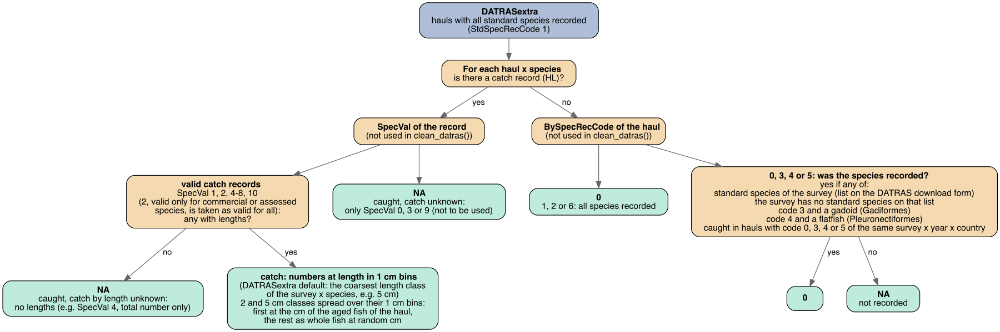

# NEA DATRAS: zeros, NA and length bins in the catch data

Zeros are made by joining `haul` with `len_freq`. A zero is only real if the species was recorded in that haul. The catch is in 1 cm length bins (see [Length bins](#length-bins)).

## How catch, zeros and NA are set

As in DATRASextra (`clean_datras()`), we keep only hauls where all standard species were recorded (`StdSpecRecCode` 1). When a species is not in the HL table for a haul, it gets a catch of 0. For a non-standard species, especially in older years, this risks fake zeros, so we add two checks for each haul × species (figure made by `figures/workflow_datras.R`):

**The species is in the HL table for the haul.** Each catch record has a `SpecVal` code that says whether its catch data can be used. We use the catch from records with codes 1, 2, 4–8 and 10. If a species in a haul has only records with codes 0, 3 or 9 (not to be used), it gets NA instead of a number. If we dropped those records, the join with `haul` would give a 0, but the species may well have been caught, we just don't trust the catch numbers (in 1,751 such cases we have aged fish of the species from that haul). Code 2 means the data are valid only for commercial or assessed species; we treat it as valid for all species (some Spanish surveys have only code 2 in some years, for many species). For comparison, FISHGLOB drops codes 0 and 2, and DATRASextra uses all codes. FISHGLOB stores no zeros, so its data don't have this issue directly; it comes back only if users create zeros themselves.

Codes 4–8 have no lengths (e.g. 4: total number only; 6: weight only). `len_freq` is by length, so it has no catch for these records. If a species in a haul has valid records but none with lengths, it also gets NA: it was caught, but its catch by length is unknown. Before, these got a 0 when zeros were created. This applies to 10,842 haul × species (0.34% of the 3,152,223 haul × species in the table with zeros; NS-IBTS 7,343, BITS 3,291, BTS 195, others 13), in 3,444 of 125,333 hauls (2.7%); almost all have code 4. In NS-IBTS, 4 haul × species have lengths in some catch categories and only a total number in others; their catch in `len_freq` is then too low.

**The species is not in the HL table for the haul.** We look at the haul's `BySpecRecCode` to find out whether the species was recorded before we give it a zero:

- Codes 1, 2 or 6: all species were recorded, so the absence is a real 0.
- Codes 0, 3, 4 or 5: by-catch species were not, or only partly, recorded. The absence is a 0 only if any of these holds:
  - The species is standard in the survey. The only list I have found is on the [DATRAS download page](https://datras.ices.dk/Data_products/Download/Download_Data_public.aspx), after selecting a survey, quarter and year; it is not in the NS-IBTS manual, and I assume it is correct.
  - The survey has no standard species on that list.
  - Code 3 and the species is a gadoid (Gadiformes).
  - Code 4 and the species is a flatfish (Pleuronectiformes).
  - The species was caught in such hauls of the same survey × year × country. For example, in BITS, herring and sprat are not standard species, but they occur in 463 and 414 of the 608 code-0 hauls.

Otherwise it is NA (not recorded).

In `len_freq`, each haul × species with NA catch has one row with `num`, `wgt` and `lngt` NA. In the mean length at age, aged fish from these haul × species are kept, but are not counted in the number of aged fish per length bin that the weights are computed from; they get the weight of their bin.

## Length bins

`len_freq` has 1 cm bins for all surveys and species, as `ind_age` has lengths in cm. This differs from DATRASextra: `add_numbers_at_length()` uses one bin width per survey × species, the coarsest length class in its catch records, starting at its smallest length. Before, 85 of the 284 survey × species in `len_freq` had other bins: 0.1 cm (68, where all lengths are in mm, e.g. FR-CGFS and IE-IGFS), 0.5 cm (8, e.g. herring and sprat in SWC-IBTS) and 5 cm (9, NS-IBTS cod, haddock, plaice and 6 more, because of a few records in 5 cm classes). 7 more had 1 cm bins that did not start at a whole cm (e.g. NS-IBTS herring and sprat: 23.5 to 24.5 cm).

What we do (in `get_north_east_atlantic_datras.R`):

- `add_numbers_at_length()` with 1 cm bins starting at whole cm; lengths in mm are summed into them.
- Catch in 2 and 5 cm classes is spread over their 1 cm bins. The aged fish of a haul are part of its catch, so in each class the caught fish are first placed at the cm of the aged fish of that haul. The rest are placed as whole fish at random cm of the class (fixed seed, so the result is the same in each run with the same data); where the count is not a whole number, the remaining part of a fish goes to one random cm. Where fewer fish were caught than aged in a class, the catch is split over the cm of the aged fish, in proportion to them.
- The spread catch goes into `add_numbers_at_length()` as 1 cm records, so it is rounded as all catch: per haul × 1 cm bin to whole fish (0.5 rounds to 0).

In the species we use, only NS-IBTS has such classes: 5 cm classes (no 2 cm classes), in 1966–2001, and only for fish of 60 cm and over. In the raw data, these are 4,002 of the 3,354,928 NS-IBTS catch records of these species (0.12%) and 11,560 of 293,675,321 fish (0.004%). Of the records, 3,430 are Dutch (85.7%), 420 `SUHH` (10.5%, 1974–1982), 151 German (3.8%, 1989) and 1 Danish (1988). As a share of the species' fish in NS-IBTS: pollack 6.2%, ling 1.2%, cod 1.2%, anglerfish 0.55%, turbot 0.33%, saithe 0.21%, hake 0.05%, haddock, dab and plaice < 0.01%.

Why the aged fish first: 2,762 of the 4,002 classes (69.0%) hold 1 fish. 371 classes have aged fish of the same haul in them (545 aged fish). With all caught fish placed at random cm (100 runs), on average 67.9% of these aged fish (63.7 to 73.9%) were in a cm without catch in their haul. The aged fish in these classes are spread about evenly over the 5 cm (21, 20, 17, 21 and 21%, from the lowest cm), which fits placing the rest at random with the same chance for each cm. Spreading the rest evenly instead (e.g. 0.2 fish per cm for a class of 1 fish) would lose such fish in the rounding.

Effects on the outputs, compared with the previous bins (`haul` and `ind_age` unchanged):

- `len_freq`: DATRASextra rounds per bin, so where the bins changed, the catch per haul × species changed in 18,990 of 836,017 haul × species (2.3%; NS-IBTS 17,724, NSSS 704, EVHOE 311), in total by +374 of 564,857,968 fish. Two haul × species lost their catch, with six length classes of 0.5 fish each, now each rounded to 0 (before, some were summed in wider bins): plaice `NS-IBTS:1997:1:FR:35HT:GOV:B019:16` and cod `NS-IBTS:1973:1:NL:64T0:DHT:5:5`.
- `wgt`: +0.5% in total (23,053 to 23,173 t), +4 to +7% in the surveys with lengths coded in mm (FR-WCGFS 6.8%, FR-CGFS 6.2%, NSSS 6.1%, IE-IGFS 5.7%, BTS-VIII 5.5%, IE-IAMS 4.1%). In these, 97.6 to 100% of the caught fish are at a whole cm (NSSS: at a whole or half cm), so they are cm classes coded in mm. DATRASextra computes the weight at the bin midpoint: with 0.1 cm bins a fish of 23.0 cm was weighed as 23.05 cm, now as 23.5 cm, as in the surveys with lengths in cm.
- Hauls with more aged than caught fish ([`nea_datras_n_k_issue.md`](nea_datras_n_k_issue.md)): 4,134 of 86,380, before 4,164; 44 hauls in NS-IBTS and SWC-IBTS changed, from the rounding (before the catch without lengths was set to NA).
- Mean length at age: same rows and numbers of fish. 7,714 of the 45,726 rows with sex "all" changed (16.9%), by a median of 0.09 cm (0.29%), 90% by less than 0.6 cm (1.6%); most in NS-IBTS (6,404 of 11,939 rows, 53.6%). The largest change (+42.1 cm) is saithe age 0 in NS-IBTS 1995 Q4, 2 fish: one of 104 cm (implausible at age 0) and one of 13 cm, whose 1 cm bin has no catch in the sample (weight 1); its 5 cm bin had 26 caught fish.

## Codes (haul table, HH)

`StdSpecRecCode` ([TS_StdSpecRecCode](https://vocab.ices.dk/?ref=88)): were the standard species recorded?

| Code | Meaning |
|---|---|
| 0 | No standard species recorded |
| 1 | All standard species recorded |
| 2 | Pelagic standard species recorded |
| 3 | Roundfish standard species recorded |
| 4 | Individual standard species recorded |

`BySpecRecCode` ([TS_BySpecRecCode](https://vocab.ices.dk/?ref=89)): were the other (by-catch) species recorded?

| Code | Meaning |
|---|---|
| 0 | No by-catch species recorded |
| 1 | Open ended by-catch list: all species, even species complexes |
| 2 | Closed by-catch list: all species recorded |
| 3 | Closed by-catch list: gadoid species recorded |
| 4 | Closed by-catch list: flatfish species recorded |
| 5 | Closed by-catch list: various species recorded |
| 6 | Open ended fish species list and limited benthos list |

## Inconsistencies

Species caught where the code says they were not recorded.

Surveys with standard species on the form (non-standard species caught):

| Survey | `BySpecRecCode` | Hauls | Caught in |
|---|---|---|---|
| BITS | 0 (none) | 608 | herring 463, sprat 414 |
| BTS | 0 (none) | 108 | dab 101, whiting 77 |
| NS-IBTS | 4 (flatfish only) | 128 | poor cod 28, pouting 23 |

Surveys without standard species on the form (so code 0 would mean nothing recorded), yet many species caught:

| Survey | `BySpecRecCode` | Hauls | Caught in |
|---|---|---|---|
| SP-ARSA | 0 (none) | 1,026 | hake 945, conger 771 |
| SP-NORTH | 0 (none) | 764 | four-spot megrim 725, hake 720 (all 14 species in the data caught) |
| SP-PORC | 0 (none) | 190 | hake 187, blackbelly rosefish 187 |
| NL-BSAS | 0 (none) | 143 | turbot 142, brill 128 |
| DYFS | 0 (none) | 27 | plaice 27, sole 27 |

## To do

Ask the survey contacts:

- Which species are standard in each survey? The only list found is on the DATRAS download form, and it is not defined.
- Is `BySpecRecCode` reliable? See [Inconsistencies](#inconsistencies).
- Can `SpecVal` 2 (valid only for commercial or assessed species) be used for all species we use? It is now taken as valid for all; some Spanish surveys have only code 2 in some years.
