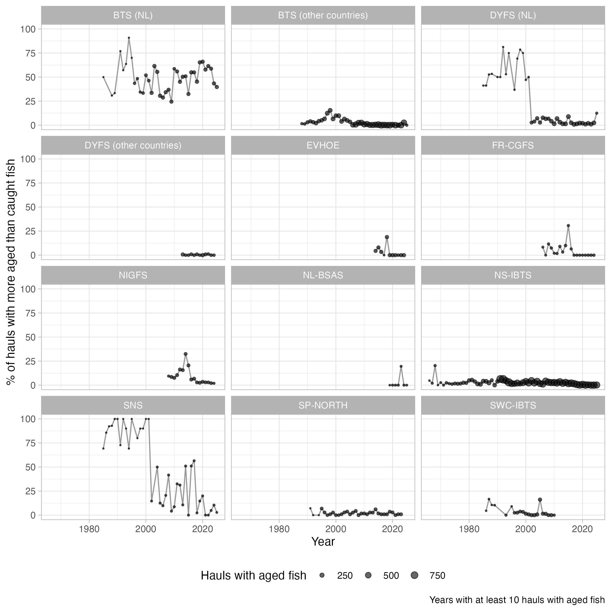

# NEA DATRAS: aged sample larger than catch

The aged fish of a species in a haul (sum of `n` in `ind_age`) should be a subsample of the fish caught in that haul (sum of `num` in `len_freq`). In 4.7% of the hauls with aged fish (4,090 of 86,360), at least one species has more aged fish than caught fish. This is in the raw DATRAS data, not caused by the pipeline. It is also not caused by random haul assignment: these numbers are from data read with `strict = TRUE` (aged fish without a haul are only assigned where exactly one haul matches), and the examples have their own station and haul numbers in the raw data. Examples read from the raw exchange files: [`nea_datras_aged_exceeds_catch.md`](nea_datras_aged_exceeds_catch.md).

| Survey | % of hauls |
|---|---|
| SNS | 30.8 |
| BTS | 13.5 |
| NIGFS | 9.3 |
| DYFS | 5.1 |
| FR-CGFS | 5.0 |
| EVHOE | 3.6 |
| NS-IBTS | 2.5 |
| BITS | 1.3 |
| Other surveys | 0 to 3.0 |

## Over time

Surveys with 2% or more of hauls affected, BTS and DYFS split into Dutch and other hauls (`figures/n_k_trend_nea_datras.R`):

## Sources

### Dutch beam trawl surveys (BTS, DYFS, SNS)

Where it is common, it comes from Dutch hauls, not from the surveys as a whole. Mostly flatfish (sole, turbot, brill, plaice, flounder).

| Source | % of hauls | Compared with |
|---|---|---|
| Dutch hauls, BTS | 47.3 | GB, DE, BE hauls in BTS: 0.3 to 5.5 (by country and quarter) |
| Dutch hauls, DYFS | 4.7 (Q4) to 7.3 (Q3) | DE, BE hauls in DYFS: 0.6 or less |
| SNS (Dutch only) | 30.8 | |
| All Dutch hauls, all surveys | 21.7 | Any other country: 10.2 or less (Lithuania 10.2, Northern Ireland 9.3) |

The survey manuals ([WGBEAM inshore, 2024](https://doi.org/10.17895/ices.pub.25382437), SNS and DYFS; [WGBEAM offshore, 2023](https://doi.org/10.17895/ices.pub.21603336), BTS) describe the age sampling:

* Germany and the Netherlands follow "a fixed stratification by area and length class: a fixed number of otoliths by cm class and area is collected" (10 subareas in SNS, 17 in the Dutch DYFS); Belgium "a fixed stratification by haul and length class".
* "there can be shifts in the accuracy of the stratification for biological data collection, e.g. current registration by haul compared to earlier registration by flatfish area".

The data match this for SNS and the Dutch DYFS, with a change in 2002 (the manuals do not give the year):

| | Hauls with aged fish, 1997–2001 | Hauls with aged fish, 2002–2006 | % of hauls with more aged than caught, up to 2001 | Same, from 2002 |
|---|---|---|---|---|
| SNS | 10 of 44 to 57 each year | 41 to 51 of 46 to 51 | 87.5 | 20.1 |
| Dutch DYFS | 14 to 22 of 226 to 290 | 114 to 169 of 272 to 309 | 56.4 | 3.5 |
| Dutch BTS | 64 to 107 of 121 to 162 | 143 to 157 of 150 to 163 | 46.3 | 47.5 |

Up to 2001, the aged fish of each SNS subarea seem to be registered under one haul (10 hauls per year, 10 subareas), and likewise in the Dutch DYFS. This explains why these hauls have more aged than caught fish. The Dutch BTS does not change in 2002, and the manual says that there "Registration of biological data are always done on a per haul basis"; not explained.

### EVHOE 2018 (corrected)

81.9% of hauls before the correction (other EVHOE years 0 to 8.0), now 3.6% for EVHOE overall. 2018 is the only EVHOE year with `DataType` C (numbers per hour), but the catch numbers are per haul. Converted from per hour, the catch of the 30-minute hauls is halved, and length classes with one fish (0.5) are rounded to 0 by `DATRAS::addSpectrum()` (used by DATRASextra). Raw data: [`nea_datras_evhoe_2018.md`](nea_datras_evhoe_2018.md). Corrected in the pipeline, see [`nea_datras_datatype_corrections.md`](nea_datras_datatype_corrections.md).

### NIGFS and FR-CGFS

NIGFS (mostly cod) 15.4% of hauls up to 2015, 3.6% after; FR-CGFS 9.1% and 0.7%. The IBTS manual for these surveys ([SISP 15, 2017](https://doi.org/10.17895/ices.pub.3519)) does not describe how their age samples are collected. Not explained.

### Other surveys

Mostly a few hauls, probably reporting errors. Example of a single haul that looks like aged fish reported under the wrong haul: `NS-IBTS:2006:3:SE:77AR:GOV:495:44` caught haddock of 10–17 cm only, but has 9 aged haddock of 32–50 cm; the other haul of the same ship in the same rectangle (45G1) on the same day (StNo 496) caught haddock of 26–50 cm, including all these lengths, and has no aged haddock.

## Consequence

The mean length at age pools all hauls in a survey × year × quarter, so it is hardly affected. Using the aged fish per haul (e.g. weights per haul, or the haul position of aged fish) is not reliable where this is common: SNS and the Dutch DYFS up to 2001, the Dutch BTS in all years, and NIGFS and FR-CGFS up to 2015.

## To do

- Dutch SNS and DYFS up to 2001: ask the Dutch survey contacts whether the aged fish were registered by subarea under one haul. If so, give them a pooled `haul_id` (as the aged fish without a haul, see [`nea_datras_aged_without_haul.md`](nea_datras_aged_without_haul.md)), with a fixed rule by survey, country and years.
- Dutch BTS: ask why about half of the hauls have more aged than caught fish, in all years.
- NIGFS and FR-CGFS: ask how the age samples are collected, and whether this changed around 2015.
